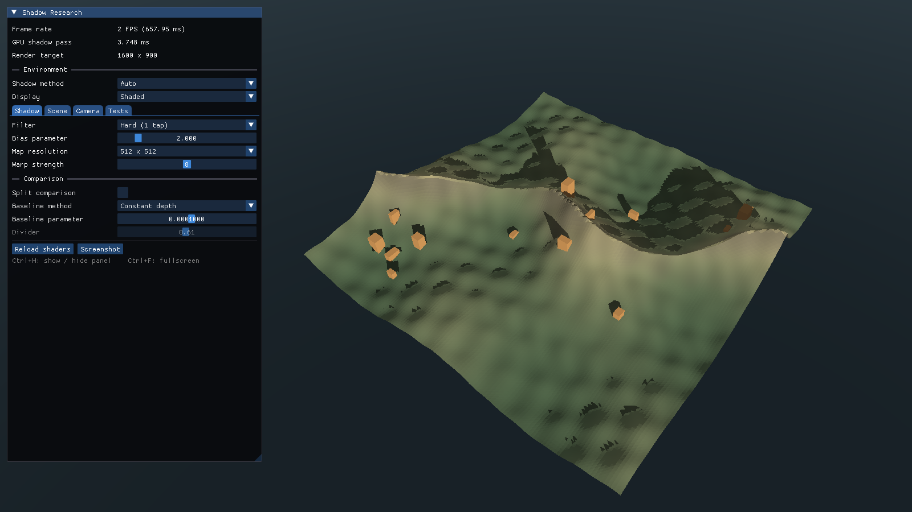
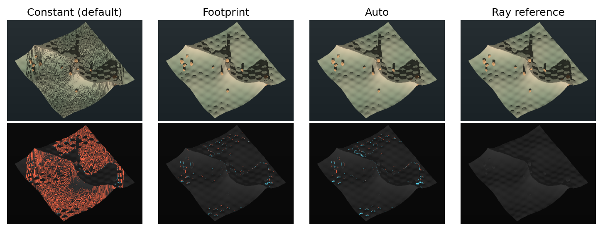
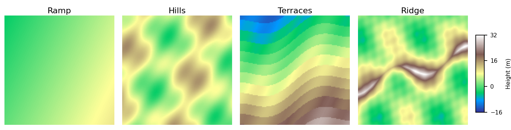
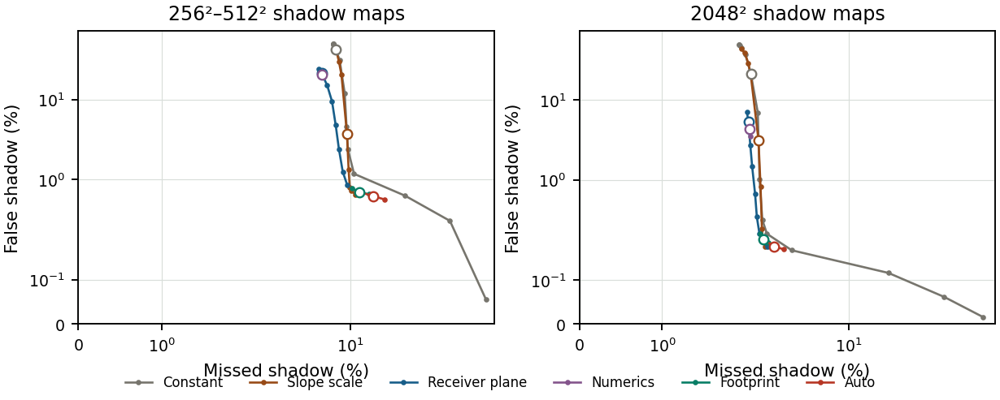
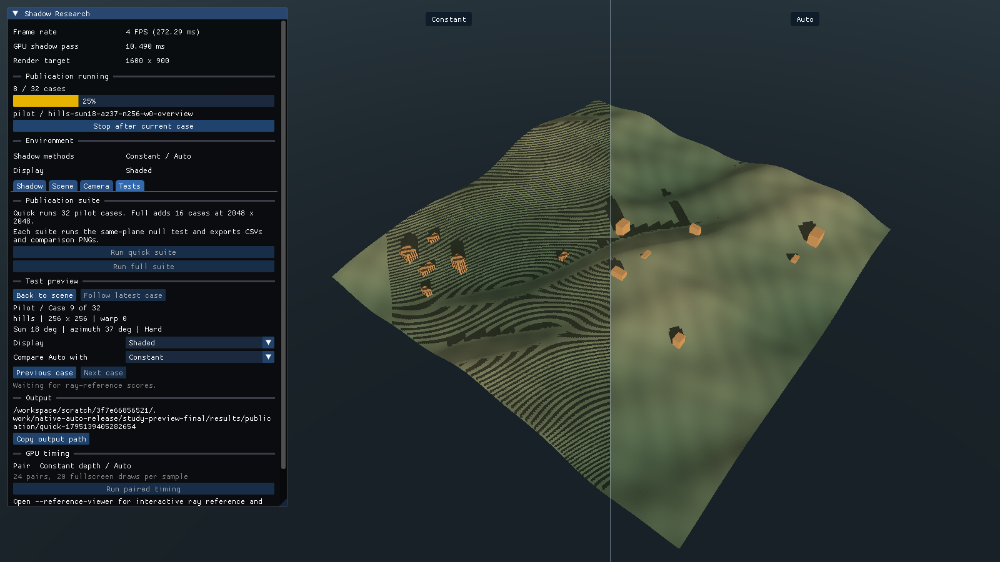
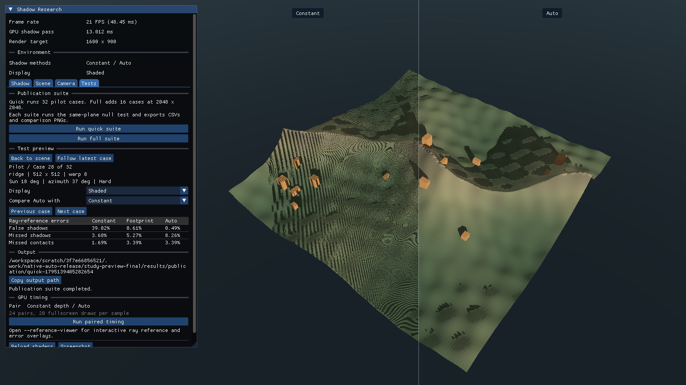

# gfx-research-shadow-auto-bias

[](https://en.cppreference.com/w/cpp/20)
[](https://www.opengl.org/)
[](https://cmake.org/)

Auto adjusts the depth tolerance of a directional shadow map to the local texel footprint and the geometry sampled by that texel. The project evaluates the method on warped terrain with a geometric ray reference and separate measurements for false shadows, lost shadows, and lost contacts.

The native C++ application renders the heightmap and the box casters in a full-window OpenGL scene. Use the floating ImGui panel to switch bias methods live or split one camera view between two methods.



*Application preview from a software OpenGL validation run.*

**Explore** · [Method](#method) · [Results](#results) · [Build](#build) · [Controls](#controls) · [Experiments](#experiments) · [References](#references)



The upper row shows the rendered surfaces. The lower row marks false shadows in orange and missed shadows in cyan. The comparison uses a 512 × 512 shadow map, warp strength 8, and a light elevation of 18°.

## Introduction

### Why adapt the depth bias?

A shadow-map texel stores the depth at one light ray. A receiver projected into that texel can lie at a different light-space position. On sloping terrain, the difference alone can create a false shadow. Raising a constant threshold reduces those artifacts, but can also erase a real shadow, especially near a contact point. A warped shadow map makes this tradeoff spatially dependent by concentrating texels around a selected region.

Position-dependent bias based on inverse-mapped texel size has a precedent in Kozlov's treatment of perspective shadow maps. Signed receiver-plane correction has a precedent in the work of Dou et al. Lauritzen uses a caster depth gradient to model within-texel depth variance. Auto combines those ideas with an additional allowance based on the difference between the sampled caster plane and the receiver plane. The benchmark measures the contribution of that allowance separately. [Kozlov, 2004](https://developer.nvidia.com/gpugems/gpugems/part-ii-lighting-and-shadows/chapter-14-perspective-shadow-maps-care-and-feeding) · [Dou et al., 2014](https://jcgt.org/published/0003/04/08/) · [Lauritzen, 2007](https://developer.nvidia.com/gpugems/gpugems3/part-ii-light-and-shadows/chapter-8-summed-area-variance-shadow-maps)

## Method

### Warp and texel footprint

The separable warp acts on each normalized light-plane coordinate $p\in[-1,1]$. Strength $\alpha=0$ gives uniform sampling. With shadow-map width $N$ and light-space half-width $D$, the local first-order world-space texel width is $\ell(p)$.

```math
\begin{aligned}
w(p)&=\frac{(1+\alpha)p}{1+\alpha |p|},
&
w^{-1}(q)&=\frac{q}{1+\alpha-\alpha |q|},\\
w'(p)&=\frac{1+\alpha}{(1+\alpha |p|)^2},
&
\ell(p)&\simeq\frac{2D}{N\,w'(p)}.
\end{aligned}
```

For $D=128$ m, $N=2048$, and $\alpha=8$, the first-order texel width grows from about **1.39 cm at the center to 1.125 m at the edge**. This is a factor of 81 along an axis.

For a receiver at $\mathbf p_r$, let $u_i=(w(p_{r,i})+1)/2$ be its normalized texture coordinate. The algorithm inverse-maps offsets one texel to either side of the receiver and uses half the larger displacement as the footprint component $h_i$.

```math
\begin{aligned}
u_i^\pm &= \operatorname{clamp}\left(u_i\pm N^{-1},\tfrac{1}{2N},1-\tfrac{1}{2N}\right),\\
F_i &= \max_{\sigma\in\{-,+\}}
       \left|w^{-1}(2u_i^\sigma-1)-p_{r,i}\right|,
& h_i &= \tfrac12 F_i .
\end{aligned}
```

### Auto

Let $\mathbf g_r$ be the receiver's depth gradient, $\mathbf e_r$ its componentwise error estimate, and $\mathbf g_c$ the caster gradient stored in the center texel. The bias combines a numerical allowance $B_N$, a footprint allowance $B_F$, and a gradient-mismatch allowance $B_\Delta$.

```math
\begin{aligned}
B_N &= E_p+|\mathbf g_r|\cdot\boldsymbol\eta+\frac{2.5}{2^{24}-1}
       +\gamma_5\bigl(|z_r|+1+|\mathbf g_r|\cdot\mathbf F\bigr),\\
B_F &= k\bigl(|\mathbf g_r|+\mathbf e_r\bigr)\cdot\mathbf h,\\
B_\Delta &= k|\mathbf g_r-\mathbf g_c|\cdot\mathbf h,\\
B &= s\,(B_N+B_F+B_\Delta),
& \gamma_n &= \frac{n\,2^{-24}}{1-n\,2^{-24}} .
\end{aligned}
```

Here $E_p$ is the float32 receiver-position error expressed in depth units, $\boldsymbol\eta$ bounds inverse-warp coordinate error, and the D24 term allows for depth quantization. Absolute values on vectors act componentwise. The defaults are $k=0.9$ and $s=2$. The caster plane is stored for terrain with two octahedral SNORM16 components in a 32-bit texel. An unavailable or singular plane sets $B_\Delta=0$.

For two affine depth planes, $B_\Delta/k$ is exactly the largest possible change in their depth difference for a displacement within the chosen rectangle.

```math
\max_{|\delta_i|\le h_i}
\bigl|(\mathbf g_r-\mathbf g_c)\cdot\boldsymbol\delta\bigr|
=|\mathbf g_r-\mathbf g_c|\cdot\mathbf h .
```

This equality applies to the two plane models. Across a true occlusion boundary, the same allowance can cover a real separation and turn a shadowed point into a lit point.

### Visibility test

Each tap at $\mathbf p_t$ compares the depth predicted by the receiver plane against the stored depth $z_t$. The tap is classified as shadowed when

```math
z_r+\mathbf g_r\cdot(\mathbf p_t-\mathbf p_r)-z_t>B+T_t .
```

The extra tolerance $T_t$ covers gradient and inverse-warp uncertainty at that tap. An extrapolation outside the light-depth range falls back to $z_r$. The one-tap comparison and the optional 3 × 3 PCF mode use the same per-tap decision. [Implementation details](docs/IMPLEMENTATION.md)

## Results

The benchmark uses four procedural 16-bit heightmaps and a double-precision triangle-ray reference. The planar ramp is used to calibrate baselines. The hills, terraces, and ridge are held out for comparison. The pilot has 32 configurations, including eight ramp cases. The 2048 × 2048 profile has 16 configurations, including four ramp cases.



The table reports averages over the 12 held-out 2048 × 2048 cases. **False shadow** is measured over lit pixels and **missed shadow** over truly shadowed pixels. **Missed contact** restricts the latter denominator to terrain within 2 m of the footprint of the box hit by the reference ray. Balanced error gives the first two rates equal weight.

| Method | False shadow | Missed shadow | Missed contact | Balanced error |
|---|---:|---:|---:|---:|
| Default constant ($10^{-4}$) | 21.33% | 2.20% | 1.89% | 11.76% |
| Calibrated slope scale | 0.82% | 2.55% | 2.42% | 1.68% |
| Calibrated receiver plane | 0.21% | 2.51% | 2.65% | **1.36%** |
| Numerics ($B_N$) | 4.31% | 2.15% | 2.65% | 3.23% |
| Footprint ($B_N+B_F$) | 0.19% | 2.65% | 2.65% | 1.42% |
| Auto ($B_N+B_F+B_\Delta$) | **0.18%** | 3.16% | 2.65% | 1.67% |

The footprint accounts for most of the improvement over the numerical baseline. Adding $B_\Delta$ at the default scale lowers the false-shadow rate by about 0.016 percentage points and increases the missed-shadow rate by 0.51 points. In the lower-resolution pilot, the corresponding changes are −0.08 and +2.67 points. The calibrated receiver plane gives the lowest balanced error among the fixed comparisons in both profiles.



## Build

The native application uses **C++20**, **OpenGL 4.6**, **CMake 3.25+**, Git, and Python with Jinja2 for GLAD generation. The desktop renderer uses the same [gfx-research-base](https://github.com/Terrasil/gfx-research-base) v0.3 as the other native experiments. CMake fetches its sources and dependencies on the first configure. A graphics driver with an OpenGL 4.6 core context is required at runtime.

On Windows with Ninja, run the following from the project directory.

```powershell
python -m pip install Jinja2
cmake -S . -B cmake-build-release -G Ninja -DCMAKE_BUILD_TYPE=Release
cmake --build cmake-build-release --parallel
ctest --test-dir cmake-build-release --output-on-failure
.\cmake-build-release\shadow-auto-bias.exe
```

Launch either `shadow-auto-bias.exe` or `gfx-research-shadow-auto-bias.exe` to open the same 3D application. The standalone command-line study is `shadow-auto-bias-benchmark.exe`.

A multi-configuration generator uses `--config Release` and places the executables under its `Release` directory. The build copies the shaders and bundled heightmaps beside the desktop executables.

Set `-DGFX_RESEARCH_BASE_LOCAL_PATH=/path/to/gfx-research-base` to use a local checkout. Use `-DGFX_RESEARCH_BUILD_APP=OFF` for a dependency-free CPU benchmark build. On Linux the GLFW window backend also requires the development headers for X11 or Wayland, according to the selected CMake options.

## Controls

Drag the scene with the left mouse button to orbit, with the right button to pan, and scroll to zoom. Press **Ctrl+H** to toggle the panel or **Ctrl+F** for fullscreen. **Screenshot** saves the current scene under `results/captures` beside the executable.

| Panel section | Controls |
|---|---|
| Environment | Shadow method, shaded view, visibility mask, bias magnitude and shadow-map depth |
| Shadow | Method parameter, hard shadows or equal-weight 3 × 3 PCF, map resolution, warp strength, and a split comparison with an adjustable divider |
| Scene | Ramp, hills, terraces and ridge, box casters, sun elevation and azimuth. Drop a PGM onto the window to use your own terrain |
| Camera | Overview and contact presets, orbit distance, yaw, pitch, target and field of view |
| Tests | Quick and full publication suites, live case preview, per-case errors, run output path and paired GPU timing |

Start the app with `--reference-viewer` to open the analytical comparison with ray-reference error overlays and PNG and CSV exports. The live 3D view builds its depth map on the GPU. The analytical viewer uses the ray-sampled inputs from the experimental harness.

The timing test warms each method with 40 draws and records 24 pairs. Each sample consists of 20 fullscreen shadow draws. The order alternates between pairs. The CSV in `results/timing` reports GPU time per draw for the visibility shader.

## Publication suites

Open **Tests** and select **Run quick suite** for the 32 pilot cases, or **Run full suite** for all 48 cases in the manuscript comparison. The full suite adds 16 production-resolution cases at 2048 × 2048. Both suites use the fixed study settings and run the same-plane null checks. The 3D viewport follows the current terrain, light direction, shadow-map resolution and warp while the CPU scores the case. It shows Constant or Footprint on the left and Auto on the right. **Stop after current case** records a cancelled run and keeps the finished cases.

Use **Previous case** and **Next case** to inspect completed cases, **Follow latest case** to return to the running case, and **Back to scene** to restore the interactive settings. The displayed false-shadow, missed-shadow and missed-contact rates come from the scored 480 × 360 ray-reference view. The interactive GPU preview uses the same case settings in a perspective view. The paired GPU timing test shows the method being timed.



<details>
<summary>Completed case and ray-reference scores</summary>



</details>

The app creates `results` beside the executable. The **Output** section shows the absolute path, including the run folder after a suite starts. You can copy it directly from the panel. Each run gets a new folder under `results/publication`. Launch with `--results DIR` to use a different output root.

| File in a run | Contents |
|---|---|
| `suite.txt` | Suite type, completion status, and case counts |
| `pilot/quality.csv`, `pilot/null.csv`, `pilot/manifest.txt` | Pilot scores, same-plane null results, and reproducibility settings |
| `pilot/captures/*/comparison.png` | Six comparison figures covering the four terrains and two contact views. The rows show shaded terrain and ray-reference errors |
| `production/quality.csv`, `production/null.csv`, `production/manifest.txt` | Production-size sensitivity results from the full suite |

The native app also accepts `--publication-quick` and `--publication-suite` to export the same data and figures from a command prompt.

## Experiments

The standalone CPU entry point accepts explicit output directories and can run the extended sweep or a single scene. Its default output is a new run under `results/benchmarks` beside the executable.

```bash
./cmake-build-release/shadow-auto-bias-benchmark --out runs/pilot
./cmake-build-release/shadow-auto-bias-benchmark --profile production --out runs/production
python tools/analyze.py runs/pilot --production runs/production --out runs/analysis
```

For data saved by **Run full suite**, pass the run's `pilot` and `production` subdirectories to `tools/analyze.py` to regenerate the publication tables and parameter summaries.

| Profile | Shadow map resolutions | Warp strengths | Light elevations | Azimuths | Cases |
|---|---|---|---|---|---:|
| Pilot | 256, 512 | 0, 8 | 18°, 38° | 37° | 32 |
| Production-size sensitivity | 2048 | 8, 16 | 18°, 38° | 37° | 16 |
| Extended sweep (`--profile full`) | 256, 512, 1024, 2048 | 0, 4, 8, 16 | 12°, 18°, 38°, 58° | 37°, 113° | 512 |

The archived profiles use one tap per output pixel at 480 × 360. Each case evaluates 40 bias settings. The `full` method ID in the CSV denotes Auto. The `full` command-line profile denotes the 512-case sweep. Use `--pcf` for a separate 3 × 3 filter experiment. Use `--heightmap my-terrain.pgm` to load a PGM P2 or P5 image with up to 1024 samples per axis.

`results/` contains the archived manifests, score counts, null tests, captures, calibration and parameter sweeps. Hardware timings remain open. Use `--gl-check DIR` to compare the analytical OpenGL and CPU masks. Use `--live-check DIR` to check the split comparison, orbit camera and GPU depth against the ray-sampled depth map. Use `--preview-check DIR` to check the live publication preview and review completed cases. The included application previews were captured with software OpenGL.

A portable WebGL preview can also be generated from the same shader. Generate fixtures with `shadow-auto-bias-benchmark --out runs/pilot --fixtures viewer/cases`, then run `python tools/build_viewer.py --fixtures viewer/cases`. This writes `shadow-auto-bias.html`.

| Location | Contents |
|---|---|
| `src/main.cpp`, `src/live_gui.inl` | Native application and floating ImGui panel |
| `src/live_renderer.cpp`, `shaders/` | Real-time camera and light rasterization, display modes and shared GLSL shadow comparison |
| `src/reference_viewer.cpp`, `src/shadow_renderer.cpp` | Analytical comparison, ray overlays and quality exports |
| `src/benchmark.cpp`, `src/shadow.hpp` | CPU experiment, terrain and ray reference |
| `src/publication_suite.cpp`, `src/publication_figure.cpp` | Publication runs, progress and comparison figures |
| `heightmaps/` | Four 16-bit PGM scenes |
| `tests/`, `tools/` | Reference test, analysis, figure generation and software shader checks |

## References

- **Simon Kozlov.** *Perspective Shadow Maps: Care and Feeding.* GPU Gems, chap. 14, 2004. Inverse-projected texel footprints and position-dependent bias. [Chapter](https://developer.nvidia.com/gpugems/gpugems/part-ii-lighting-and-shadows/chapter-14-perspective-shadow-maps-care-and-feeding)
- **Hang Dou et al.** *Adaptive Depth Bias for Shadow Maps.* Journal of Computer Graphics Techniques 3(4), 146–162, 2014. Receiver-plane evaluation at the light ray through the sampled texel. [Paper](https://jcgt.org/published/0003/04/08/)
- **Andrew Lauritzen.** *Summed-Area Variance Shadow Maps.* GPU Gems 3, chap. 8, 2007. Caster depth gradients in the second moment. [Chapter](https://developer.nvidia.com/gpugems/gpugems3/part-ii-light-and-shadows/chapter-8-summed-area-variance-shadow-maps)
- **Daniel Weiskopf and Thomas Ertl.** *Shadow Mapping Based on Dual Depth Layers.* Eurographics, 2003. Adaptive bias using two stored depths. [DOI](https://doi.org/10.2312/egs.20031069)
- **Michael Wimmer, Daniel Scherzer, and Werner Purgathofer.** *Light Space Perspective Shadow Maps.* EGSR, 143–151, 2004. Nonuniform projection for shadow-map sampling. [DOI](https://doi.org/10.2312/EGWR/EGSR04/143-151)
- **William T. Reeves, David H. Salesin, and Robert L. Cook.** *Rendering Antialiased Shadows with Depth Maps.* SIGGRAPH, 283–291, 1987. Percentage-closer filtering. [Paper](https://graphics.pixar.com/library/ShadowMaps/paper.pdf)

